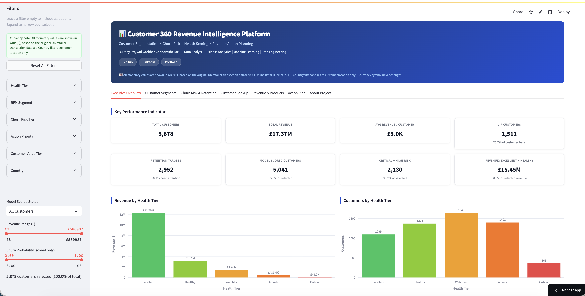

# Customer Intelligence Lens

**Customer Segmentation · Churn Risk Prediction · Health Scoring · Revenue Action Planning**


An end-to-end customer analytics project that turns raw online-retail transactions into customer segments, churn predictions, health scores, and prioritised retention actions, all explored through an interactive Streamlit dashboard.

---

## Table of Contents

- [Overview](#overview)
- [Business Questions](#business-questions)
- [Dataset](#dataset)
- [Tech Stack](#tech-stack)
- [How It Works](#how-it-works)
- [Project Structure](#project-structure)
- [Getting Started](#getting-started)
- [Running the Pipeline](#running-the-pipeline)
- [Dashboard](#dashboard)
- [Methodology](#methodology)
- [Limitations](#limitations)
- [Future Improvements](#future-improvements)
- [Acknowledgements](#acknowledgements)
- [Author](#author)

---

## Overview

This project uses transaction history from a UK-based online retailer to answer a practical question: **how can a business identify its most valuable customers, predict who is likely to leave, and decide where to focus retention and growth effort?**

The pipeline covers:

1. Cleaning and validating raw transaction data
2. Exploratory data analysis
3. Building customer-level features
4. RFM segmentation
5. Churn labelling and model training (Logistic Regression, Random Forest, XGBoost)
6. Model explainability with SHAP
7. A composite customer health score and action priorities
8. A DuckDB SQL layer that produces reusable reporting tables
9. A multi-tab Streamlit dashboard

## Business Questions

- Who are the most valuable customers?
- Which customers are at risk of churning?
- Which customer groups generate most of the revenue?
- Who should get retention campaigns, loyalty rewards, or growth nurturing?
- How can customer health be summarised in a single business-friendly score?

## Dataset

| Property | Value |
|---|---|
| Name | Online Retail II |
| Source | [UCI Machine Learning Repository](https://archive.ics.uci.edu/dataset/502/online+retail+ii) |
| Period | December 2009 to December 2011 |
| Sheets | Year 2009-2010, Year 2010-2011 |
| Columns | Invoice, StockCode, Description, Quantity, InvoiceDate, Price, Customer ID, Country |

All monetary values are treated as GBP (£), consistent with the UK-based retailer.

The dataset has no churn label, no customer demographics, and no marketing or campaign history. Churn is engineered from purchase behaviour (see [Methodology](#methodology)).

## Tech Stack

| Category | Tools |
|---|---|
| Language | Python 3.11 |
| Data processing | pandas 2.2.2, NumPy 1.26.4, openpyxl 3.1.2 |
| Machine learning | scikit-learn 1.4.2, XGBoost 2.0.3 |
| Explainability | SHAP 0.45.1 |
| Visualisation | Plotly 5.22.0, matplotlib 3.8.4, seaborn 0.13.2 |
| SQL analytics | DuckDB 1.1.3 |
| Dashboard | Streamlit 1.35.0 |
| Utilities | python-dotenv, tqdm, joblib, Jupyter |

## How It Works

```
Raw Excel data
      ↓
Inspection & quality audit
      ↓
Data cleaning  →  clean_transactions.parquet
      ↓
EDA
      ↓
Customer feature engineering  →  customer_features.parquet
      ↓
RFM segmentation  →  rfm_segments.parquet
      ↓
Churn labelling  →  churn_model_base.parquet
      ↓
Model training  →  churn_model.pkl
      ↓
SHAP explainability
      ↓
Customer health score  →  customer_360.parquet
      ↓
DuckDB SQL analytics layer  →  reports/sql_outputs/*.csv
      ↓
Streamlit dashboard
```

Intermediate and final outputs are stored as Parquet and CSV for fast local analytics.

## Project Structure

```
.
├── app/
│   └── streamlit_app.py          # Streamlit dashboard
├── data/
│   ├── raw/                      # Source Excel file (not tracked)
│   ├── interim/                  # Intermediate outputs
│   └── processed/                # Cleaned and final datasets
├── models/                       # Trained model and metrics
├── notebooks/                    # Exploratory notebooks
├── reports/
│   ├── figures/                  # Charts and SHAP plots
│   ├── screenshots/              # Dashboard screenshots
│   └── sql_outputs/              # SQL reporting tables (CSV)
├── sql/                          # 10 DuckDB SQL queries
├── src/                          # Pipeline scripts (01 to 12)
├── environment-local.yml         # Conda environment
├── requirements.txt              # Pip requirements (dashboard)
├── runtime.txt                   # Python version for deployment
└── README.md
```

## Getting Started

### 1. Clone the repository

```bash
git clone https://github.com/bhupendrayz/customer-intelligence-lens.git
cd customer-intelligence-lens
```

### 2. Set up the environment

**Option A: Conda (full pipeline)**

```bash
conda env create -f environment-local.yml
conda activate customer360
```

**Option B: pip (dashboard dependencies only)**

```bash
pip install -r requirements.txt
```

> `requirements.txt` only contains what the dashboard needs. To run the full pipeline (model training, SHAP), use the Conda environment, which also includes scikit-learn, XGBoost, and SHAP.

### 3. Add the dataset

Download [Online Retail II](https://archive.ics.uci.edu/dataset/502/online+retail+ii) and place it at:

```
data/raw/online_retail_II.xlsx
```

## Running the Pipeline

Run the scripts in order from the project root:

```bash
python src/01_load_and_inspect.py
python src/02_data_quality_audit.py
python src/03_clean_data.py
python src/04_verify_clean_outputs.py
python src/05_eda.py
python src/06_build_customer_features.py
python src/07_rfm_segmentation.py
python src/08_churn_labeling.py
python src/09_train_churn_model.py
python src/10_shap_explainability.py
python src/11_customer_health_score.py
python src/12_sql_analytics_layer.py
```

| Step | Script | Purpose |
|---|---|---|
| 01 | `01_load_and_inspect.py` | Load both Excel sheets and print the schema |
| 02 | `02_data_quality_audit.py` | Audit nulls, duplicates, and anomalies |
| 03 | `03_clean_data.py` | Remove nulls, cancellations, and invalid rows |
| 04 | `04_verify_clean_outputs.py` | Assertion checks on the cleaned data |
| 05 | `05_eda.py` | Revenue trends and customer behaviour |
| 06 | `06_build_customer_features.py` | Customer-level feature table |
| 07 | `07_rfm_segmentation.py` | RFM scores and business segments |
| 08 | `08_churn_labeling.py` | Time-window churn labels with leakage checks |
| 09 | `09_train_churn_model.py` | Train and compare churn models, assign risk tiers |
| 10 | `10_shap_explainability.py` | Explain model drivers with SHAP |
| 11 | `11_customer_health_score.py` | Health score and action priorities |
| 12 | `12_sql_analytics_layer.py` | Run DuckDB SQL queries and export reporting tables |

## Dashboard

```bash
streamlit run app/streamlit_app.py
```

The app opens at `http://localhost:8501`.

| Tab | Purpose |
|---|---|
| Executive Overview | KPI cards, revenue, health, churn, and priority charts |
| Customer Segments | RFM analysis and segment summary |
| Churn Risk & Retention | Probability distribution, risk charts, top at-risk customers |
| Customer Lookup | Per-customer 360 profile |
| Revenue & Products | Monthly trend, top countries, top products |
| Action Plan | Priority breakdown and CSV downloads |
| About Project | Pipeline summary and dataset notes |

<!-- Add your own screenshots after running the app, e.g.:

-->

## Methodology

### RFM segmentation

Customers are scored 1 to 5 on Recency, Frequency, and Monetary value using quantile bins (with a rank-percentile fallback for tied values). Scores are combined into business segments such as Champions, Loyal Customers, At Risk, Cannot Lose, and Hibernating.

### Churn labelling

The dataset has no churn label, so one is created with a time-window approach:

| Window | Date range |
|---|---|
| Observation | December 2009 to June 2011 |
| Prediction | July 2011 to December 2011 |

- `churned = 1`: purchased in the observation window but **not** in the prediction window
- `churned = 0`: purchased in **both** windows
- Customers who only appear in the prediction window are excluded from training

**Leakage prevention:** all model features are computed only from observation-window transactions (prefixed `obs_`).

### Model training

Logistic Regression, Random Forest, and XGBoost are trained and compared on an 80/20 stratified split. Logistic Regression is used as the final model because its performance is competitive and its coefficients are directly interpretable.

### Churn risk tiers

| Tier | Churn probability |
|---|---|
| Critical Risk | 80% or higher |
| High Risk | 60% to 79% |
| Medium Risk | 40% to 59% |
| Low Risk | below 40% |

### Customer health score (0 to 100)

| Component | Max points | Basis |
|---|---|---|
| RFM | 40 | `(rfm_total_score / 15) × 40` |
| Churn safety | 30 | `(1 − churn_probability) × 30` (neutral 15 if not scored) |
| Revenue | 20 | Revenue percentile rank × 20 |
| Engagement | 10 | Repeat-buyer flag and frequency percentile |

Health tiers: Excellent (80+), Healthy (60 to 79), Watchlist (40 to 59), At Risk (20 to 39), Critical (below 20).

### SQL analytics layer

DuckDB queries the processed Parquet files directly and writes 10 reporting tables to `reports/sql_outputs/`: executive KPIs, health tiers, RFM segments, churn risk, country revenue, top customers, action priorities, monthly revenue, product revenue, and customer value tiers. Revenue totals are reconciled between Python and SQL outputs.

## Results

<!-- Run the pipeline and fill in your own numbers, for example:
| Metric | Result |
|---|---|
| Clean transaction rows | ... |
| Customers analysed | ... |
| Total revenue | ... |
| Churn model ROC-AUC | ... |
-->

## Limitations

- **Historical data:** the dataset ends in December 2011. Models would need recalibrating on current data before real-world use.
- **Engineered churn label:** churn is defined as inactivity in a time window, so seasonal buying patterns can cause false positives.
- **No demographics or campaign data:** behaviour cannot be linked to age, gender, or marketing activity.
- **Currency assumption:** values are assumed to be GBP; no exchange-rate data exists.
- **Associative, not causal:** model coefficients and SHAP values (including country effects) describe patterns, not causes.
- **Educational scope:** this is a portfolio and learning project, not a production system.

## Future Improvements

- Migrate the DuckDB SQL layer to BigQuery
- Add a Looker Studio executive dashboard
- Containerise the pipeline and app with Docker
- Add GitHub Actions for automated data validation
- Add model monitoring and drift detection
- Include product categories, seasonality, and campaign response features


- GitHub: [@bhupendrayz](https://github.com/bhupendrayz)
-
